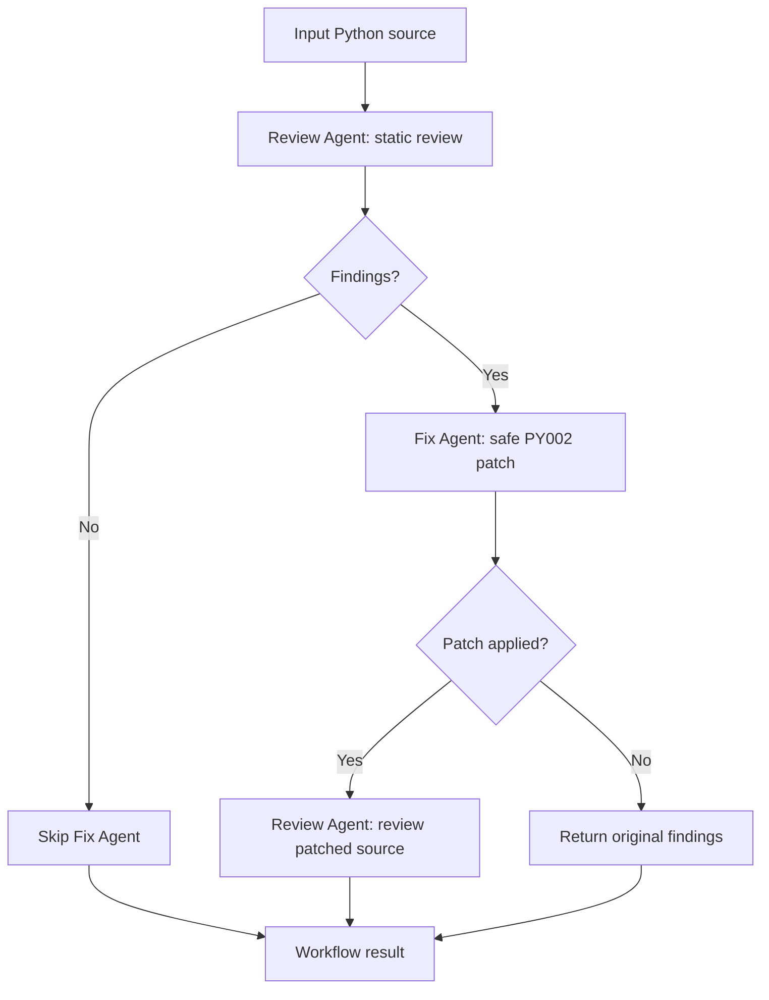

# Design: Code Review and Fix Workflow

## Goal

Demonstrate a small, runnable workflow with two cooperating Agents, sequential execution, shared state, and an end-to-end result. The Review Agent is adapted from Homework 1's code review Agent; the Fix Agent is new.

## Workflow

## Agent responsibilities

- **Review Agent** wraps Homework 1's `CodeReviewAgent`. It reads code from the shared state, runs the existing allowlisted static analysis tools, and publishes a `review_completed` message containing issue IDs and a count.
- **Fix Agent** consumes the most recent review from the shared state. It changes a bare `except:` to `except Exception:` only when the finding points to a matching standalone handler line. Unsupported findings are reported as unresolved; the Agent does not guess at a rewrite.
- **Workflow Engine** owns ordering and branching. It records requests, results, patches, and completion in the shared state.

## Shared state and communication

`WorkflowState` carries the original and current source, review runs, patches, status, and an ordered message log. Messages have a sequence number, sender, recipient, type, payload, and timestamp. Each Agent communicates its result by appending to this common state, so the next step consumes a concrete prior result. The workflow is sequential, so no locking or concurrent state writes are needed.

## Error handling and safety

The workflow rejects empty input. Review tool errors are returned by the reused Agent as structured results. The workflow does not execute submitted Python. The fixer edits a line only when the current source still matches the reviewed rule and exact safe pattern. Patches are recorded with before/after content and changed line numbers. Model-provider errors fall back to the explicit deterministic reviewer provider from Homework 1.

## Limitations and extensions

The Fix Agent currently handles only bare `except:`. Mutable defaults and `eval` findings are reported with suggestions but left for a developer because automatic rewrites can change behavior. This MVP has no parallel branches or visual workflow editor. A next step could add a human approval node before applying broader patches and a configurable retry limit.
