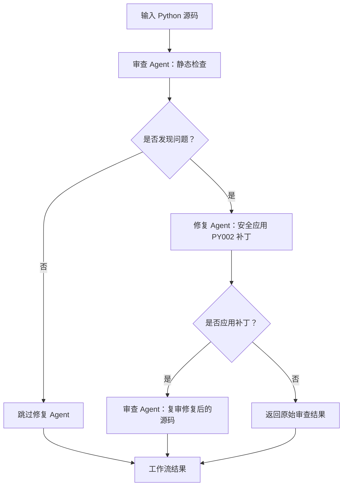

# 设计文档：代码审查与修复工作流

## 项目目标

本项目实现一个小型、可运行的多 Agent 工作流，展示两个 Agent 如何按顺序协作、通过共享状态传递信息，并完成端到端任务。审查 Agent 改编自 HW1 的代码审查 Agent，修复 Agent 为本次作业新增。

## 工作流程

## Agent 职责

- **审查 Agent**：封装 HW1 的 `CodeReviewAgent`。它从共享状态读取代码，调用已有的白名单静态分析工具，并发送包含问题编号和数量的 `review_completed` 消息。
- **修复 Agent**：读取共享状态中的最新审查结果。只有当问题位置对应的代码行仍是符合规则的独立裸异常处理语句时，才将 `except:` 改成 `except Exception:`。无法自动处理的问题会标记为未解决，不会猜测改写方式。
- **工作流引擎**：控制步骤顺序和条件分支，并把请求、审查结果、补丁及完成状态记录在共享状态中。

## 共享状态与消息传递

`WorkflowState` 保存原始源码、当前源码、每轮审查结果、补丁、工作流状态和有序消息日志。每条消息包含序号、发送方、接收方、类型、内容及时间戳。Agent 将结果追加到同一份共享状态，后续步骤读取前一步产生的具体结果。由于工作流按顺序执行，共享状态无需处理并发写入或加锁。

## 错误处理与安全

工作流会拒绝空输入。复用的审查 Agent 会将审查工具错误作为结构化结果返回。工作流不会执行用户提交的 Python 代码。修复器只有在当前源码仍符合已审查规则和明确安全模式时才修改代码，并记录补丁的修改前后内容及行号。如果模型服务调用失败，会回退到 HW1 中明确配置的确定性审查提供方。

## 限制与后续扩展

目前修复 Agent 只自动处理裸 `except:`。可变默认参数和 `eval` 等问题会给出审查建议，但留给开发者手动修复，因为自动改写可能改变程序行为。当前 MVP 没有并行分支或可视化工作流编辑器。后续可以在应用更广泛的补丁前增加人工审批节点，并设置可配置的重试次数上限。
